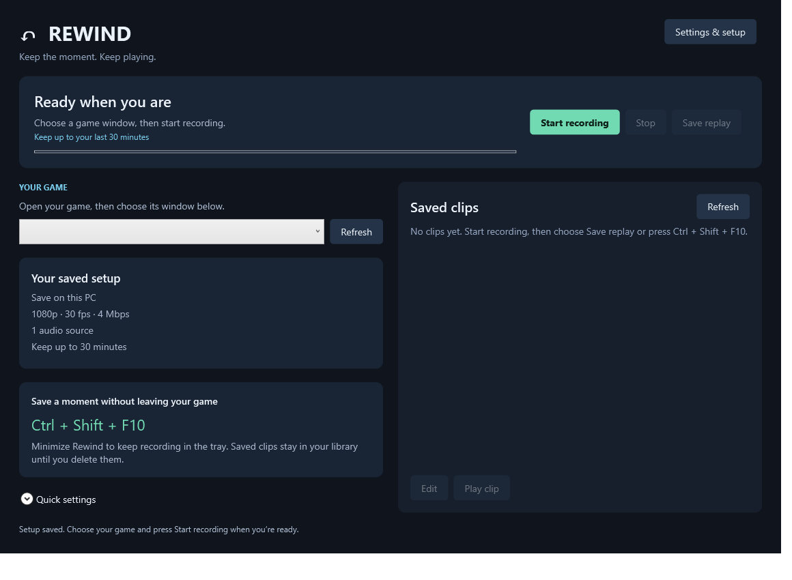

# Rewind

**Keep the context. Support your report.**

Rewind is an open-source Windows replay recorder for players on roleplay servers. Keep up to the last **30 minutes** of gameplay and selected audio, save the lead-up to an incident, and trim a copy for staff to review.

[Getting started](#getting-started) · [Storage modes](#storage-modes) · [Build from source](#build-from-source) · [Full guide](GUIDE.md) · [MIT license](LICENSE)



> Early, unsigned build. Game compatibility and performance vary; check a sample recording before relying on it for a report.

## Features

- **30-minute rolling replay** — save with **Ctrl+Shift+F10** or the Save replay button.
- **Game and voice audio** — select playback devices and an optional microphone. Selected sources are mixed into one stereo track.
- **Guided setup** — choose your game window, storage, audio, and quality in the startup wizard.
- **Local or self-hosted storage** — record on your PC or send encoded video from RAM directly to your own backend.
- **Clip trimming** — preview a saved clip and export a trimmed copy while keeping the original.
- **Smaller-files preset** — 1080p at 30 fps and 4 Mbps to reduce storage and upload bandwidth.
- **Server forwarding** — explicitly send a saved server clip to a configured multipart upload endpoint.

Rewind prepares your footage. Submit it through your community's normal reporting process, keeping enough context for a fair review. It does not submit reports automatically or provide tamper verification.

## Getting started

### Requirements

- Windows 11 x64.
- [.NET 10 Desktop Runtime](https://dotnet.microsoft.com/en-us/download/dotnet/10.0).
- Visual C++ 2015–2022 x64 redistributable.
- For local recording: [FFmpeg](https://ffmpeg.org/download.html). Trimming also needs `ffprobe.exe` alongside FFmpeg.
- For direct streaming: a running Rewind backend. FFmpeg and ffprobe run on the server instead of the gaming client.

### Record your first replay

1. Extract a built Windows package and run `Start-Rewind.cmd`. If you cloned the repository, [build it first](#build-from-source).
2. Complete the setup wizard. Choose **This PC** or **My server**, select audio devices, and pick a quality preset.
3. Choose your game window and press **Start recording** before you join a session. Borderless/windowed mode is the best starting point.
4. After a situation, press **Ctrl+Shift+F10** or **Save replay**. Shorter sessions save the footage available so far.
5. Select the saved clip and choose **Edit**. Keep the relevant lead-up and aftermath, then **Save trimmed copy**.
6. Submit the clip through your server's reporting process. Keep the original if staff need more context.

**Stop recording does not save a replay.** Save the buffer before closing the app. Closing removes the normal unsaved local buffer; saved clips remain.

## Storage modes

| | This PC | My server |
| --- | --- | --- |
| Rolling video buffer | On your PC's disk | On your server's disk |
| Gaming-client video writes | Yes | No application-managed recording files |
| Internet required | No | Network access to your server |
| FFmpeg and ffprobe | On the gaming PC | On the server |
| Trimming | Local | Server-side |

Direct streaming still captures and encodes on the gaming PC. It uses a bounded RAM queue and needs steady upload capacity above the selected video bitrate, plus audio and overhead. Run the backend on a **different machine** to move recording disk writes off your gaming PC. Windows can still page memory and write settings; manually downloading clips also writes files.

The backend is **single-owner**, protected by a shared bearer token. It is not a managed cloud service or a multi-user hosting platform. See the [backend setup guide](GUIDE.md#backend) for HTTPS, storage, authentication, Docker, and forwarding configuration.

## Keeping resource use down

Start with **Smaller files**: 1080p, 30 fps, 4 Mbps. Thirty minutes uses roughly **0.9 GB of video**, plus audio and container overhead, versus about **2.7 GB** at 12 Mbps. Saved clips need additional storage.

Hardware encoding is requested through Windows Media Foundation when supported by the driver. The app replaces older unsaved buffer segments automatically. Server mode moves storage work to another machine; it does not remove client capture and encoding work.

There are no published cross-game CPU, GPU, RAM, or FPS benchmarks yet. Choose settings using a test clip: names, chat, and voice audio need to remain clear enough for the report.

## Build from source

Install the **.NET 10 SDK** on Windows, then run:

```powershell
git clone https://github.com/madman2021/rewind.git
cd rewind
./build.ps1 -Publish
./Start-Rewind.cmd
```

The repository contains the WPF desktop app, an ASP.NET Core backend, and test utilities. Windows capture, audio, and encoding use ScreenRecorderLib with Windows Graphics Capture, WASAPI, and Media Foundation. FFmpeg handles media assembly and trimming.

See [build and validation](GUIDE.md#build-and-validation) for test commands and smoke tests. The landing page uses plain HTML, CSS, and JavaScript; its source is included in the source download.

## Current limitations

- Actual game/anti-cheat compatibility and long-running performance need game-specific testing.
- Minimized, protected, or exclusive-fullscreen windows may not produce usable frames.
- Saving waits for a complete segment and may include a few seconds after the shortcut. Trim afterwards if needed.
- Network congestion or a failed server connection stops direct-stream recording; undelivered footage can be lost. There is no local disk fallback.
- HDR tone mapping and separate audio tracks are not implemented.
- Upload forwarding uses a generic multipart endpoint. Destination-specific integrations are not included.

Read the [full guide](GUIDE.md) for detailed behavior and troubleshooting.

## Contributing

Bug reports and pull requests are welcome at [madman2021/rewind](https://github.com/madman2021/rewind). Include your Windows version, GPU, recording mode, quality settings, and steps to reproduce. Remove access tokens and private footage from logs and attachments.

## License

Rewind's own code and landing page are available under the [MIT license](LICENSE). Dependencies retain their own licenses; see [third-party notices](THIRD-PARTY-NOTICES.md) and [licenses](licenses/). FFmpeg is installed separately and is not bundled with the Windows download.

